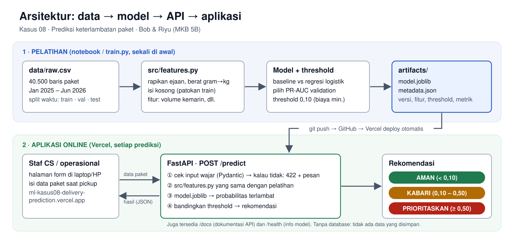

# Prediksi Keterlambatan Paket · Tim Bob & Riyu (MKB 5B)

**Kasus:** 08 · Keterlambatan Paket · **Aplikasi:** https://ml-kasus08-delivery-prediction.vercel.app · **Video:** _[tautan video]_

[](https://colab.research.google.com/github/McDingleBob/ml-kasus08-delivery-prediction/blob/main/notebooks/ML_Kasus08_Final.ipynb)

| Anggota | NIM | Bagian yang dikerjakan |
|---|---|---|
| Bob Nolen Barnabas Munthe | 2406157 | Repositori dan pipeline awal, `src/features.py` + `train.py` (pelatihan ulang), API FastAPI dan halaman aplikasi, validasi masukan, deploy Vercel, evaluasi *test*, README dan diagram arsitektur |
| Muhammad Riyu Saputra | 2403287 | *Notebook* final: pembersihan data (ejaan, berat gram), EDA, fitur buatan (volume kemarin, kelonggaran janji, pickup malam), perbandingan model, *tuning*, dan pemilihan *threshold* |

## Arsitektur



## Masalah dan pengguna

Kepala operasional hub ekspedisi di Bandung ingin tahu, **saat paket dijemput**, paket mana yang kemungkinan terlambat. Penggunanya staf layanan pelanggan dan operasional hub: aplikasi memberi probabilitas terlambat dan rekomendasi **aman**, **kabari pelanggan**, atau **prioritaskan**, supaya pelanggan bisa dikabari lebih awal. Brief: [nurhikam/mkb-ml-project · kasus 08](https://github.com/nurhikam/mkb-ml-project/tree/main/kasus/08-keterlambatan-paket). Data sintetis.

## Data dan pembersihan

40.500 baris, 13 kolom, Januari 2025–Juni 2026. Angka di tabel dihitung pada train + validation (33.256 paket unik), kecuali duplikat (seluruh data).

| Masalah yang ditemukan | Jumlah baris | Cara menangani |
|---|---:|---|
| Baris duplikat persis | 500 | dihapus (`drop_duplicates`); satu baris = satu paket |
| Ejaan kota tidak baku (`Jkt`, `DKI Jakarta`, `Sby`, `bali`, …; 28 varian) | 922 | disatukan dengan kamus menjadi 15 kota |
| Ejaan layanan tidak baku (`EXP`, `Express`, `reg`, …; 7 varian) | 662 | disatukan menjadi EXPRESS / REG / HEMAT |
| Berat = −1 (kode tidak tercatat) | 66 | dijadikan kosong, lalu diisi median berat train (1,34 kg) |
| Berat > 50 (diduga tercatat dalam gram) | 1.019 | dibagi 1.000; tidak ada nilai antara 44 dan 100, dan median setelah dibagi sama dengan median paket normal |
| Jarak kosong | 644 | diisi median jarak kota yang sama di train |
| Cuaca kosong | 315 | kategori `tidak_diketahui` |
| `volume_hub_hari` (total hari itu, belum diketahui saat pickup) | semua | tidak dipakai; diganti `volume_hub_kemarin` |

Tidak ada baris yang dibuang selain duplikat. Semua patokan pengisian dihitung dari train saja.

## Hasil

Split waktu sesuai brief: train Jan–Des 2025 (26.633), validation Jan–Mar 2026 (6.623), test Apr–Jun 2026 (6.744). PR-AUC dihitung sebagai *average precision*.

| Model | PR-AUC *validation* | PR-AUC *test* |
|---|---:|---:|
| Tebakan acak (proporsi terlambat) | 0,219 | 0,139 |
| *Baseline*: regresi logistik, fitur asli | 0,409 | 0,360 |
| Regresi logistik (C = 0,1) + fitur buatan (**final**) | **0,605** | **0,362** |

| Biaya keputusan (*test*) | Dikabari | Recall | Biaya |
|---|---:|---:|---:|
| Kabari semua paket | 100% | 100% | Rp29.025.000 |
| *Baseline* (threshold 0,01) | 100% | 100% | Rp29.025.000 |
| **Model final (threshold 0,10)** | 53% | 80% | **Rp23.425.000** |

*Threshold* yang dipakai: **0,10** untuk "kabari pelanggan", karena threshold ini membuat total biaya di validation paling kecil (paket terlambat tanpa kabar Rp50.000, kabar keliru Rp5.000; secara teori sekitar 5.000 / 55.000 ≈ 0,09). Probabilitas ≥ 0,50 → "prioritaskan" (kebijakan tim, brief tidak memberi biayanya).

Kenaikan PR-AUC di validation hampir seluruhnya datang dari musim sibuk Maret 2026 (tertangkap oleh volume hub kemarin). Di bulan biasa (Jan+Feb validation: 0,373 vs 0,371) dan di test, model final hampir setara *baseline*; manfaat yang tersisa ada pada keputusan, yaitu biaya ±19% lebih rendah daripada mengabari semua paket. Model dan threshold tidak diubah setelah test dibuka.

## Cara menjalankan

```bash
pip install -r requirements-dev.txt
python -m unittest discover -s tests -v          # test
python train.py                                  # melatih ulang; hasil sama dengan notebook
uvicorn app.api.main:app --reload --port 7860    # API + aplikasi
```

Buka `http://localhost:7860` (form aplikasi), `/docs` (dokumentasi API), `/health` (status). Versi online di-deploy di Vercel dan otomatis diperbarui setiap push ke `main`.

Contoh `POST /predict`:
```json
{"jam_pickup": 20, "kota_tujuan": "Makassar", "jarak_km": 1500, "jumlah_transit": 4, "layanan": "EXPRESS",
 "janji_hari": 2, "berat_kg": 3, "metode_bayar": "COD", "cuaca_saat_pickup": "hujan_lebat", "volume_hub_kemarin": 11000}
```
`jarak_km`, `berat_kg`, `cuaca_saat_pickup`, dan `volume_hub_kemarin` boleh kosong (`null`) dan diisi dari patokan train. Masukan yang tidak wajar (jam 25, berat −1 atau > 50 kg, kota/layanan tidak dikenal, teks di kolom angka, kolom tambahan, JSON rusak) ditolak dengan HTTP 422 beserta penjelasannya; aplikasi tidak berhenti.

## Struktur repositori

```
notebooks/ML_Kasus08_Final.ipynb  notebook dari cleaning, EDA, fitur, model, threshold, sampai evaluasi test
data/raw.csv                      data mentah dari pengajar (SHA-256 2821b50e…a600ab)
src/features.py                   cleaning + fitur, dipakai saat pelatihan (train.py) dan saat prediksi (app/)
train.py                          melatih ulang model final dari data (tanpa membuka test)
artifacts/                        model.joblib + metadata.json (versi, fitur, threshold, metrik) + hasil_test.json
app/                              API FastAPI (app/api/main.py) dan halaman aplikasi (app/static/index.html)
tests/                            unit test cleaning, fitur, pelatihan, dan validasi masukan
docs/                             diagram arsitektur (svg + png)
```

## Keterbatasan

- Model hanya tahu kondisi saat pickup; gangguan di perjalanan tidak bisa diprediksi.
- Di hari biasa (tanpa lonjakan volume) model hampir tidak lebih baik dari *baseline*; manfaatnya terutama saat hub kebanjiran paket.
- Belum dipastikan apakah `jumlah_transit` adalah rencana (tersedia saat pickup) atau realisasi; jika realisasi, ada kebocoran informasi.
- Konversi berat > 50 sebagai gram adalah dugaan kuat, bukan kepastian dari klien.
- `volume_hub_hari` berbeda antarpaket pada tanggal yang sama; volume kemarin memakai median per hari. Di aplikasi, petugas harus mengisi volume kemarin dari catatan hub.
- Model dan threshold dipilih pada validation yang sama, sehingga angka validation cenderung sedikit optimis. Periode test pernah dievaluasi tim dengan model lain sebelumnya (lihat notebook bagian 10).
- Data sintetis; biaya Rp0 untuk prediksi yang benar adalah asumsi.

## Daftar periksa sebelum dikumpulkan

- [ ] Repositori bersifat publik dan setiap anggota memiliki *commit*
- [x] *Notebook* dapat dijalankan ulang dari awal sampai akhir tanpa galat
- [x] *Baseline* wajib dilaporkan dan dibandingkan
- [x] Data *test* hanya dibuka satu kali, di akhir
- [x] `artifacts/metadata.json` berisi versi model, fitur masukan, *threshold*, dan metrik
- [x] Aplikasi dapat dibuka orang lain melalui tautan, termasuk dari ponsel
- [x] Aplikasi tidak berhenti mendadak ketika menerima masukan yang tidak wajar
- [ ] Laporan paling banyak 6 halaman dan video paling lama 5 menit
